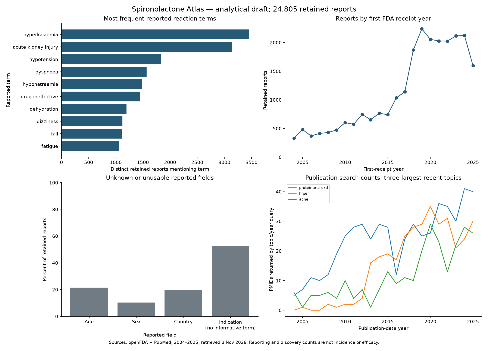

# Phase 3 — descriptive analysis

Reviewed 3 November 2026. Source window: first FDA receipt 2004–2025; openFDA API update 28 October 2026; retrieval 3 November 2026. Cohort: 24,805 conservatively selected, single-ingredient, same-entry suspect reports. Publication counts cover 2004–2025; trial status is the retrieval-time record.

## Main findings

Hyperkalaemia is the most frequent normalized reaction term: 3,452 reports (13.9% of the selected cohort), followed by acute kidney injury (3,133; 12.6%). These are report mentions; reactions overlap and are not incidence estimates or proof of causation. Capitalization variants were deduplicated within reports before ranking. Historical MedDRA synonyms were not merged. [Reaction data](../public/data/adverse-reactions.json).

No informative indication was available in 12,955 reports (52.2%). This includes blank fields and explicit unknown/unusable terms, deduplicated at report level. Another 679 reports contained at least one exact term in the narrow outside-reference-label topic list. That is a vocabulary-screening result, not a confirmed off-label prescribing share. [Record-level results and exact term lists](../data-pipeline/clean/phase-3-analysis.json).

## Q1 — reported reactions, sex and age

| Reported term       | Reports | Share of selected reports |
| ------------------- | ------- | ------------------------- |
| hyperkalaemia       | 3,452   | 13.9%                     |
| acute kidney injury | 3,133   | 12.6%                     |
| hypotension         | 1,832   | 7.4%                      |
| dyspnoea            | 1,566   | 6.3%                      |
| hyponatraemia       | 1,487   | 6.0%                      |
| drug ineffective    | 1,453   | 5.9%                      |
| dehydration         | 1,197   | 4.8%                      |
| dizziness           | 1,121   | 4.5%                      |
| fall                | 1,119   | 4.5%                      |
| fatigue             | 1,064   | 4.3%                      |

Source: normalized [reaction export](../public/data/adverse-reactions.json), retrieved 3 November 2026. “Drug ineffective” is a reported term, not necessarily an adverse reaction. Counts do not sum to the cohort because multiple terms can occur in one report.

| Hyperkalaemia subgroup | Numerator / reports in subgroup | Within-group reporting share |
| ---------------------- | ------------------------------- | ---------------------------- |
| sex: female            | 1,387 / 12,129                  | 11.4%                        |
| sex: male              | 1,781 / 10,125                  | 17.6%                        |
| sex: unknown           | 284 / 2,551                     | 11.1%                        |
| ageBand: 75+           | 1,510 / 7,537                   | 20.0%                        |
| ageBand: unknown       | 381 / 5,316                     | 7.2%                         |
| ageBand: 45–64         | 610 / 5,132                     | 11.9%                        |
| ageBand: 65–74         | 883 / 4,611                     | 19.1%                        |
| ageBand: 18–44         | 42 / 1,751                      | 2.4%                         |
| ageBand: <18           | 26 / 458                        | 5.7%                         |

Source: [stratified term counts](../public/data/adverse-reactions-filtered.json) and [report denominators](../public/data/report-summary.json), retrieved 3 November 2026. These unadjusted shares describe selected reporting groups. Age, underlying disease, co-medication and reporting patterns can confound comparisons. They do not establish sex-specific or age-specific treatment risk. Denominators include every selected report in the relevant group, including reports without hyperkalaemia.

## Q2 — what can be said about off-label reporting?

A mutually exclusive report-level topic screen gives the following categories. A label-topic match still needs population, formulation, add-on-treatment and other qualifiers; it does not establish approved use. The reference is the current US Aldactone tablet label, not the actual jurisdiction or label at the time of the report.

| Topic screen                                                 | Reports | Share of selected reports |
| ------------------------------------------------------------ | ------- | ------------------------- |
| label-topic-needs-qualifiers                                 | 6,874   | 27.7%                     |
| label-topic-needs-qualifiers + outside-reference-label-topic | 7       | 0.0%                      |
| label-topic-needs-qualifiers + unresolved-topic              | 375     | 1.5%                      |
| no-informative-indication                                    | 12,955  | 52.2%                     |
| outside-reference-label-topic                                | 629     | 2.5%                      |
| outside-reference-label-topic + unresolved-topic             | 43      | 0.2%                      |
| unresolved-topic                                             | 3,922   | 15.8%                     |

Source: cached report-level analysis, exact vocabulary and rules in [analyse.py](../data-pipeline/scripts/analyse.py) and [analysis JSON](../data-pipeline/clean/phase-3-analysis.json), reviewed 3 November 2026; reference [US label](https://labeling.pfizer.com/showlabeling.aspx?id=520). The mapping is intentionally narrow and non-exhaustive. Missing reports may differ systematically from informative reports. Summing the older source-term usage rows would double-count reports with multiple synonymous indications. **Decision: do not publish an off-label prescribing percentage or a three-way labelled/off-label/unspecified donut.** Show indication completeness and clearly named topic counts instead.

## Q3 — research activity

| Topic query            | PMIDs, 2004–2008 | PMIDs, 2021–2025 | Absolute change |
| ---------------------- | ---------------- | ---------------- | --------------- |
| proteinuria-ckd        | 45               | 182              | +137            |
| hfpef                  | 3                | 135              | +132            |
| acne                   | 23               | 112              | +89             |
| resistant-hypertension | 28               | 80               | +52             |
| hirsutism-pcos         | 38               | 78               | +40             |
| gender-affirming       | 0                | 70               | +70             |
| hair-loss              | 9                | 41               | +32             |
| central-serous         | 0                | 26               | +26             |
| hidradenitis           | 0                | 21               | +21             |
| pms-pmdd               | 9                | 0                | -9              |

Source: [PubMed topic/year query export](../public/data/research-publications.json), retrieved 3 November 2026. Values sum five annual query counts; topic and publication-date searches may overlap. Exact strings, translations and PMID lists are retained in the raw cache. Changes in indexing, terminology and search sensitivity affect comparisons. Small early baselines make ratios unstable. Zero returned by a query does not prove no relevant research exists. Research volume is not evidence quality.

The retained trial set has 227 distinct NCT IDs, including one missing start year. Of these, 124 are marked COMPLETED and 50 UNKNOWN at retrieval; registration or completion does not establish positive results. Study conditions/phases/countries can overlap. Detailed condition screening and evidence appraisal are separate tasks. [Trial records](../public/data/trials.json), retrieved 3 November 2026.

## Q4 — seriousness, outcomes and time

| Seriousness category | Reports | Share of selected reports |
| -------------------- | ------- | ------------------------- |
| serious              | 21,979  | 88.6%                     |
| non-serious          | 2,824   | 11.4%                     |
| unknown              | 2       | 0.0%                      |

Source: [report summary](../public/data/report-summary.json), retrieved 3 November 2026. Serious reporting is strongly selected; these shares do not describe all treated patients.

Hospitalization is flagged in 13,987 reports and death in 2,187. Seriousness flags overlap and must not form an unqualified mutually exclusive outcome donut. The death flag is not a drug-attributable mortality or case-fatality estimate. Reaction-level outcomes are separate fields. [Seriousness criteria](../public/data/seriousness-criteria.json) and [reaction outcomes](../public/data/reaction-outcomes.json), retrieved 3 November 2026.

Reports first received in 2019 number 2,239, compared with 1,599 in 2025. The later count does not establish improved safety, reduced exposure or a causal trend. Reporting practices, utilization, follow-up and source coverage can all change. [Annual counts](../public/data/report-summary.json).

## Q5 — hyperkalaemia reporting context

The union of the two English spelling variants occurs in 3,452 retained reports; it equals the normalized hyperkalaemia term count in this release. Raw co-reported drug names include furosemide (906 reports), ramipril (425), bisoprolol (353) and metformin (332). These are co-reporting counts, not a ranked interaction-risk analysis. Brand aliases such as Lasix remain separate, and source text may include errors. [Co-reported names](../public/data/hyperkalaemia-coreported.json), retrieved 3 November 2026.

No exposed comparator cohort, standardized medication histories or validated drug-class mapping was available for this analysis. Therefore it cannot identify independent risk factors, interaction effect sizes, PRR or ROR. The separately sourced label interaction table is reference evidence and must not be presented as a causal result from these co-reporting counts.

## Q6 — labels and regions

The specific US Aldactone tablet label includes qualifying add-on hypertension treatment; the reviewed UK Aldactone 25 mg SmPC does not list hypertension in section 4.1 and does list malignant ascites. The Carospir suspension scope differs from the US tablet scope. These are product-document comparisons, not a claim about every product in each country. [Source-specific indication entries](../public/data/indications.json), reviewed 3 November 2026.

No dated India-specific product label was verified. Indian approval differences remain unresolved; essential-medicines listings and other countries' labels are not substitutes. SOC/body-map outputs remain unavailable without a permitted, versioned MedDRA hierarchy or a separately reviewed and honestly named manual grouping.

## Missingness and uncertainty

| Reported field | Unknown or unusable reports | Share of cohort |
| -------------- | --------------------------- | --------------- |
| ageBand        | 5,316                       | 21.4%           |
| sex            | 2,551                       | 10.3%           |
| country        | 4,915                       | 19.8%           |

Missing values were retained, not imputed. Country includes region-like values such as EU; do not label every source value a country. The cohort excludes unresolved products, combination products and reports without a matching suspect entry, so selection uncertainty remains even though extraction reconciles. No sampling confidence intervals or hypothesis tests are reported: the main uncertainties are non-random reporting, missingness, selection and classification rather than random sampling error.

## Evidence appraisal and draft insights

The [targeted appraisal](EVIDENCE_APPRAISAL.md) separates endpoint direction, evidence quality and label status. It includes full-text sections where accessible and explicitly marks abstract-only assessments. It is not a systematic review or formal GRADE evaluation. The [five draft takeaways](INSIGHT_SHORTLIST.md) are candidates for design review, not final marketing copy.

## Reproduce and inspect

Run `data-pipeline/.venv/Scripts/python.exe data-pipeline/scripts/analyse.py` from the project root. It verifies export hashes, replays the cached cohort with network disabled, checks denominators, writes the machine-readable analysis and group-rate CSV, and renders the figure below. Matplotlib and its dependencies are pinned in requirements.txt. Raw caches are required for record-level reproduction; public exports are sufficient for the aggregate portions.

The SVG companion is [available for export](figures/phase-3-overview.svg). Figure generation is analytical and does not implement the website design.
